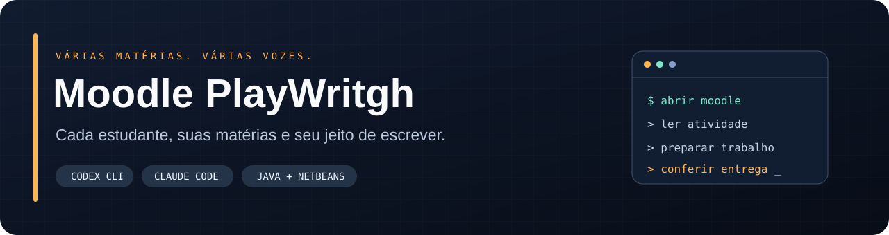
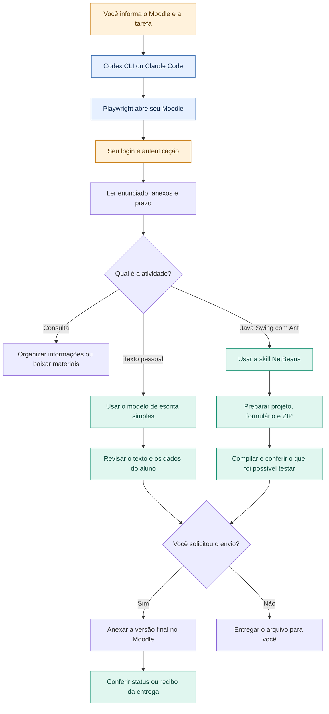

<p align="center">
  
</p>

<p align="center">
  <strong>Moodle + trabalhos Java, no seu Codex ou Claude Code.</strong><br>
  Consulte atividades, prepare arquivos e confira suas entregas em um fluxo só.
</p>

<p align="center">
  <a href="#instalação-rápida">Instalar</a> ·
  <a href="#como-o-fluxo-funciona">Ver o fluxo</a> ·
  <a href="#o-que-vem-no-pacote">Skills incluídas</a> ·
  <a href="#primeiro-uso">Começar a usar</a> ·
  <a href="#se-algo-não-funcionar">Resolver problemas</a>
</p>

---

## O que vem no pacote

| Parte | Para que serve |
| --- | --- |
| **Moodle · `moodle-playwright`** | Acessar seu Moodle, consultar cursos e prazos, baixar materiais, preencher campos, anexar arquivos e verificar o status de uma entrega solicitada. |
| **Java · `netbeans-swing-ant`** | Criar e corrigir exercícios Java Swing com Ant, manter o par `.java`/`.form` editável no Design e organizar a entrega em ZIP. Inclui uma referência de formulário nativo. |
| **Escrita simples · referência interna** | Orientar respostas pessoais e autoavaliações curtas, em primeira pessoa e com linguagem cotidiana. É um modelo dentro da skill Moodle; **não instala uma skill de redação separada**. |
| **Playwright MCP · `moodle_playwright`** | Fornecer o navegador e suas ferramentas de automação para Codex e Claude Code. |

A skill Java atende **Swing + NetBeans + Ant**. Ela não troca Maven, Gradle ou JavaFX por Ant quando o enunciado escolheu outra tecnologia. Não instala JDK ou NetBeans por conta própria.

## Como o fluxo funciona

O diagrama é renderizado pelo próprio GitHub. Escrita e Java são caminhos alternativos: o agente usa só o que a atividade exige.



**Exemplo:** você pede para preparar uma atividade de Java. O agente consulta o enunciado, usa a skill NetBeans para o projeto e confere a entrega. Se o pedido incluir enviar, ele anexa o ZIP e verifica a confirmação do Moodle. Consultar prazos não carrega a skill Java.

## Instalação rápida

### Antes de começar

- **Node.js LTS**, com `node` e `npx` no PATH. O MCP usado declara Node >= 18; prefira uma versão LTS ainda suportada.
- **Codex CLI e/ou Claude Code**, de acordo com o cliente que vai instalar, já autenticado.
- **Google Chrome** e ambiente gráfico para abrir o Moodle. O modo sem janela é opcional.
- Para implementar exercícios Java: **JDK, Apache Ant e NetBeans** conforme o projeto.
- Internet para baixar este repo, obter o MCP e acessar sua instituição.

Use seu usuário normal. Não precisa de administrador para copiar as skills e configurar o MCP. Se acabou de instalar os programas, reabra o terminal.

### Deixe o próprio agente instalar

Cole esta mensagem no Codex ou Claude Code:

```text
Instale para meu usuário o pacote do repositório público
https://github.com/JoaoVitorSteffenDoNascimento/MoodlePlayWritgh.
Leia o README e scripts/install.cjs. Identifique meu sistema e meu cliente
(Codex ou Claude Code) e execute o instalador com --client correspondente.
Quero as skills Moodle e NetBeans para Java, o modelo de escrita simples
interno e o perfil permissivo do MCP. Preserve minhas outras configurações
e os backups. Não copie credenciais nem sessões de outras pessoas.
Confira o registro do MCP e me avise quando reiniciar o cliente.
Se existir um servidor manual com o mesmo nome, concilie apenas esse
servidor com backup, sem remover outros MCPs.
```

O agente precisa de acesso à internet e aos arquivos do seu usuário. A instalação não contorna bloqueios do sistema ou da organização.

### Linux · Bash

Com Git instalado:

```bash
git clone https://github.com/JoaoVitorSteffenDoNascimento/MoodlePlayWritgh.git
cd MoodlePlayWritgh
```

Escolha **um** comando:

```bash
bash install.sh --client codex
```

```bash
bash install.sh --client claude
```

```bash
bash install.sh --client both
```

O último instala nos dois clientes e exige ambos disponíveis. No macOS, o mesmo wrapper pode ser usado com os requisitos instalados; a execução nativa ainda não foi verificada neste projeto.

### Windows · PowerShell

Sem precisar de Git ou Bash, baixe e extraia:

```powershell
Invoke-WebRequest -Uri 'https://github.com/JoaoVitorSteffenDoNascimento/MoodlePlayWritgh/archive/refs/heads/main.zip' -OutFile 'MoodlePlayWritgh.zip'
Expand-Archive -Path '.\MoodlePlayWritgh.zip' -DestinationPath '.\MoodlePlayWritgh-download' -Force
Set-Location '.\MoodlePlayWritgh-download\MoodlePlayWritgh-main'
```

Escolha **um** comando:

```powershell
node .\scripts\install.cjs --client codex
```

```powershell
node .\scripts\install.cjs --client claude
```

```powershell
node .\scripts\install.cjs --client both
```

Também existe `install.ps1`: use `& .\install.ps1 --client claude` se a sua política permitir scripts locais. Executar pelo `node` dispensa mudar a política do PowerShell. No WSL, use o instalador Linux: o usuário do WSL é separado do Windows nativo.

### O que será alterado

| Cliente | Skills | Configuração do MCP e permissões |
| --- | --- | --- |
| Codex | `~/.agents/skills/moodle-playwright` e `~/.agents/skills/netbeans-swing-ant` | Bloco gerenciado em `~/.codex/config.toml`, respeitando `CODEX_HOME`. |
| Claude Code | `~/.claude/skills/moodle-playwright` e `~/.claude/skills/netbeans-swing-ant` | Servidor de usuário em `~/.claude.json`; regra de aprovação em `~/.claude/settings.json`. |

O instalador copia também os arquivos de referência e metadados das skills. Faz backup dos arquivos existentes que alterar e preserva os outros servidores, configurações de conta e regras de permissão. Os backups ficam ao lado do arquivo original com `.backup-...` no nome.

Pode rodar novamente: não duplica o bloco ou a regra de aprovação. Uma configuração manual conflitante do mesmo servidor faz o instalador parar **antes de modificar os arquivos**. No Claude, um recibo local permite reconhecer e atualizar a configuração criada pelo instalador.

Feche e reabra os clientes depois da instalação. O MCP será baixado pelo `npx` na primeira conexão. Se você usa `CLAUDE_CONFIG_DIR` personalizado, use a instalação manual abaixo para escolher o perfil certo.

## Primeiro uso

No **Codex**, confira o registro:

```bash
codex mcp list
```

Depois, dentro do agente:

```text
Use $moodle-playwright. Meu Moodle é https://SEU-MOODLE-AQUI.
Abra o navegador para eu entrar e liste minhas atividades com prazo nesta semana.
```

No **Claude Code**, use `/mcp` para conferir a conexão e `/moodle-playwright` para chamar a skill. Para Java, invoque `/netbeans-swing-ant`; no Codex, `$netbeans-swing-ant`.

<details>
<summary><strong>Exemplo · trabalho Java</strong></summary>

```text
Leia o enunciado desta atividade no Moodle e use netbeans-swing-ant
para preparar o projeto Java Swing com Ant. Quero o JFrame editável
na aba Design e um ZIP para entregar. Use o nome de aluno que vou informar.
Compile o projeto e explique o que conseguiu testar.
```

O navegador acessa o Moodle; o JDK, Ant e a IDE são usados no computador para implementar e verificar o trabalho.

</details>

<details>
<summary><strong>Exemplo · autoavaliação simples</strong></summary>

```text
Leia as perguntas da autoavaliação e me ajude a responder de forma simples,
em primeira pessoa, sem palavras difíceis. Use só as experiências que eu
informar. Não envie ainda; primeiro me mostre o texto.
```

O modelo de escrita fica em [escrita-simples.md](skills/moodle-playwright/references/escrita-simples.md). Ele orienta o estilo, sem atribuir ao aluno experiências, notas ou dados de outra pessoa.

</details>

## Perfil permissivo

O pacote aprova previamente as ferramentas expostas por **este MCP**, inclusive cliques, formulários, upload, JavaScript e execução de código no processo Playwright. Habilita as capacidades `vision,pdf,devtools` e `--allow-unrestricted-file-access`, que permite trabalhar fora da pasta do projeto dentro dos acessos do processo.

Isso é acesso amplo: ações podem alterar dados reais no Moodle e código pode alcançar recursos do computador. As políticas existentes do cliente, sistema e instituição continuam valendo. No Claude, regras `deny` e `ask` podem prevalecer sobre `allow`. A conta do Moodle mantém os privilégios que já tinha.

Aprovar ferramentas não solicita tarefas extras: o agente atua no trabalho que você pediu. O pacote não desativa globalmente a segurança dos clientes e não instala programas Java automaticamente.

## Login e seus dados

Cada pessoa entra com a **própria conta**, na janela do navegador de automação. A sessão pode ser reutilizada enquanto continuar válida. MFA, CAPTCHA e consentimentos podem depender de você.

Se você fornecer as credenciais ou autorizar uma fonte local específica, o agente pode preencher o login. Não existe integração automática com senhas salvas no seu Chrome pessoal nem gerenciador de senhas incluído.

Nunca envie senhas, cookies, tokens ou perfis autenticados para este repo. O trabalho usado como inspiração para o modelo de escrita não foi incluído: só o estilo geral foi documentado. A cópia compartilhada da skill NetBeans não fixa nome de aluno nem caminhos da máquina de origem.

## Se algo não funcionar

| Situação | O que fazer |
| --- | --- |
| `node`, `npx`, `codex` ou `claude` não encontrado | Instale o programa que falta e reabra o terminal. Use o cliente que você realmente tem em `--client`. |
| Chrome não encontrado | Instale Google Chrome no mesmo sistema em que o MCP roda. |
| As ferramentas não aparecem | Reinicie o cliente; confira `codex mcp list` ou `/mcp` no Claude. |
| Existe servidor manual com o mesmo nome | Faça backup e concilie apenas `moodle_playwright`. O instalador não substitui silenciosamente uma configuração diferente. |
| Erro de JSON no Claude | Corrija o arquivo indicado. O instalador para sem sobrescrever JSON inválido. |
| Usa `CLAUDE_CONFIG_DIR` personalizado | Use as configurações manuais para o perfil correto. |
| Sem interface gráfica | Acrescente `--headless` ao comando de instalação. Nesse modo, o login manual pela janela não está disponível. |
| Ant, JDK ou NetBeans ausente | Instale os componentes exigidos pelo trabalho; o MCP do navegador não os substitui. |
| Design do NetBeans não abre | Verifique o par `.java`/`.form`; compilação não prova que o GUI Builder foi testado. |
| Pasta, rede ou ferramenta bloqueada | Use um ambiente com os acessos necessários. Políticas gerenciadas não são removidas pelo pacote. |

## Atualização e instalação manual

Se clonou com Git, entre na pasta, rode `git pull --ff-only` e repita o instalador com o mesmo `--client`. Se baixou o ZIP, baixe uma versão atualizada e execute o script da nova pasta. Os backups anteriores permanecem locais.

Para instalar manualmente, copie as **duas pastas** de `skills/` para o diretório de skills do cliente. No Codex, acrescente [config/codex.toml](config/codex.toml) ao arquivo existente sem duplicar o servidor. No Claude, una [config/claude-mcp.json](config/claude-mcp.json) à `.mcp.json` do projeto e [config/claude-settings.json](config/claude-settings.json) às permissões do seu perfil. Preserve as configurações existentes. No Windows, pode ser necessário usar `npx.cmd` no campo `command`.

## Verificação do projeto

```bash
node tests/install.test.cjs
bash -n install.sh
```

Os testes usam diretórios temporários. Cobrem Codex e Claude, cópia dos recursos, backups, reinstalação, permissões existentes, conflitos e JSON inválido. Eles não entram em contas Moodle nem simulam uma entrega real.

A execução nativa no Windows/macOS e os fluxos reais de cada instituição ainda exigem validação nesses ambientes. O Playwright MCP está fixado em `0.0.82`, versão encontrada na instalação de origem. Não há promessa de compatibilidade com todos os temas, métodos de SSO ou versões do Moodle.

## Documentação

[Playwright MCP](https://github.com/microsoft/playwright-mcp) · [MCP no Codex](https://learn.chatgpt.com/docs/extend/mcp) · [Skills no Codex](https://learn.chatgpt.com/docs/build-skills) · [MCP no Claude Code](https://code.claude.com/docs/en/mcp) · [Permissões do Claude](https://code.claude.com/docs/en/permissions)
