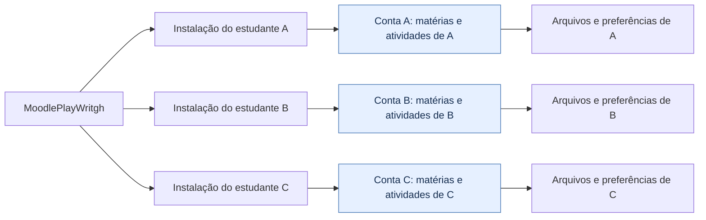
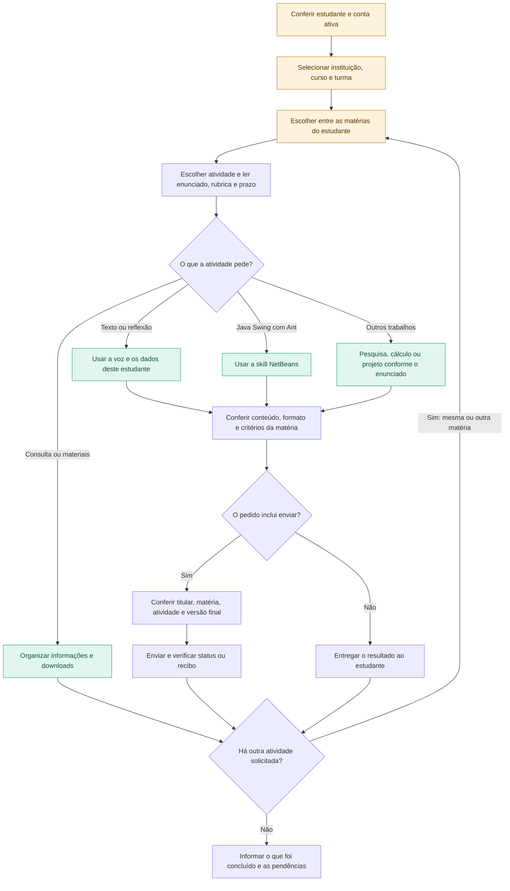

<p align="center">
  
</p>

<p align="center">
  <strong>Várias matérias. Vários estudantes. Cada um com sua conta.</strong><br>
  Organize as atividades no Codex ou Claude Code, com o contexto e a voz de cada estudante.
</p>

<p align="center">
  <a href="#instalação-rápida">Instalar</a> ·
  <a href="#como-o-fluxo-funciona">Ver o fluxo</a> ·
  <a href="#o-que-vem-no-pacote">Skills incluídas</a> ·
  <a href="#primeiro-uso">Começar a usar</a> ·
  <a href="#se-algo-não-funcionar">Resolver problemas</a>
</p>

---

## O que vem no pacote

| Parte | Para que serve |
| --- | --- |
| **Moodle · `moodle-playwright`** | Acessar seu Moodle, consultar cursos e prazos, baixar materiais, preencher campos, anexar arquivos e verificar o status de uma entrega solicitada. |
| **Java · `netbeans-swing-ant`** | Criar e corrigir exercícios Java Swing com Ant, manter o par `.java`/`.form` editável no Design e organizar a entrega em ZIP. Inclui uma referência de formulário nativo. |
| **Voz do estudante · memória local** | Adaptar o texto aos prompts, correções e exemplos aprovados de cada autor. Perfis separados, sem um modelo fixo de resposta ou uma skill externa instalada por padrão. |
| **Playwright MCP · `moodle_playwright`** | Fornecer o navegador e suas ferramentas de automação para Codex e Claude Code. |

A skill Java atende **Swing + NetBeans + Ant**. Ela não troca Maven, Gradle ou JavaFX por Ant quando o enunciado escolheu outra tecnologia. Não instala JDK ou NetBeans por conta própria.

## Como o fluxo funciona

### O mesmo pacote, instalações e contas separadas

Cada estudante instala no próprio ambiente e usa sua conta. O repositório distribui as ferramentas; ele não reúne logins, textos ou entregas numa conta compartilhada.



Se o mesmo computador for usado para atender mais de um estudante autorizado, é necessário identificar o titular, trocar a sessão e separar arquivos e perfis. O pacote atual **não implementa um servidor multiusuário nem isolamento automático de contas**. Aliases de escrita organizam a memória; não substituem isolamento do sistema operacional.

### Dentro da conta de cada estudante

A atividade pode ser de qualquer matéria. A skill escolhe o apoio pelo enunciado, não por uma disciplina fixa.



História, Matemática, Educação Física, Português e programação podem exigir formatos diferentes. A skill NetBeans participa apenas de exercícios compatíveis com Swing e Ant. Revisão de texto não é aplicada a código ou fórmulas para mudar seu estilo.

## A escrita se adapta ao autor

O antigo modelo fixo de autoavaliação foi removido. A skill agora observa **o jeito de pedir e corrigir do estudante**, usa isso como ponto de partida e refina o perfil com textos do próprio autor e versões que ele aprovou.

- **Prompts:** indícios iniciais de tom, vocabulário e objetividade, com baixa confiança. Erros de digitação não viram regras de escrita.
- **Correções explícitas:** pedidos como “mais curto” ou “menos formal” têm prioridade sobre inferências anteriores.
- **Amostras e textos aprovados:** ajudam a reconhecer ritmo e organização de cada pessoa.
- **Contexto da atividade:** o enunciado continua valendo. Uma reflexão pode ser emocional; um relatório técnico pode precisar de linguagem objetiva.

A escrita não precisa seguir sempre introdução, três argumentos e conclusão. Em uma narrativa pessoal, a ordem pode mudar e o texto pode voltar a uma lembrança, desde que combine com o autor e a atividade. A skill não inventa experiências ou emoções.

As preferências são resumidas localmente em `~/.moodle-playwright/estudantes/<alias>/escrita.json`. Não são salvos prompts completos nem o texto dos trabalhos. Use aliases diferentes quando houver mais de um autor; o perfil de A não deve orientar o trabalho de B.

Isso é **memória local de preferências**, não treinamento do modelo. O agente precisa executar o helper para ler e atualizar o perfil. Se não puder gravar arquivos, a adaptação vale apenas para a conversa atual. Cada instalação tem sua memória; não há sincronização pelo GitHub.

O helper está em [scripts/voice-profile.cjs](skills/moodle-playwright/scripts/voice-profile.cjs), dentro da skill. No cliente, você pode pedir:

```text
Mostre minhas preferências de escrita salvas para o alias principal.
```

```text
Atualize meu perfil: quero frases mais variadas e um tom pessoal quando
for uma reflexão. Em trabalhos técnicos, mantenha a linguagem objetiva.
```

```text
Apague o perfil de escrita do meu alias principal.
```

### Opção externa pesquisada

A [Humanizer, de blader](https://github.com/blader/humanizer), é uma opção para revisar ritmo, estrutura e voz usando amostras do autor. O projeto diferencia escrita pessoal de texto técnico e orienta preservar os fatos. Ela não é específica para construir narrativas não lineares; seu uso com textos em português ainda não foi avaliado neste projeto.

Ela fica como **opção**, sem download ou instalação automática neste pacote. Quem quiser pode revisar o projeto e seguir suas instruções de instalação para Codex ou Claude. A adaptação local descrita acima funciona sem essa dependência.

## Instalação rápida

### Antes de começar

- **Node.js LTS**, com `node` e `npx` no PATH. O MCP usado declara Node >= 18; prefira uma versão LTS ainda suportada.
- **Codex CLI e/ou Claude Code**, de acordo com o cliente que vai instalar, já autenticado.
- **Google Chrome** e ambiente gráfico para abrir o Moodle. O modo sem janela é opcional.
- Para implementar exercícios Java: **JDK, Apache Ant e NetBeans** conforme o projeto.
- Internet para baixar este repo, obter o MCP e acessar sua instituição.

Use seu usuário normal. Não precisa de administrador para copiar as skills e configurar o MCP. Se acabou de instalar os programas, reabra o terminal.

### Deixe o próprio agente instalar

Cole esta mensagem no Codex ou Claude Code:

```text
Instale para meu usuário o pacote do repositório público
https://github.com/JoaoVitorSteffenDoNascimento/MoodlePlayWritgh.
Leia o README e scripts/install.cjs. Identifique meu sistema e meu cliente
(Codex ou Claude Code) e execute o instalador com --client correspondente.
Quero as skills Moodle e NetBeans para Java, a adaptação à voz de cada estudante
e o perfil permissivo do MCP. Preserve minhas outras configurações
e os backups. Não copie credenciais nem sessões de outras pessoas.
Confira o registro do MCP e me avise quando reiniciar o cliente.
Se existir um servidor manual com o mesmo nome, concilie apenas esse
servidor com backup, sem remover outros MCPs.
```

O agente precisa de acesso à internet e aos arquivos do seu usuário. A instalação não contorna bloqueios do sistema ou da organização.

### Linux · Bash

Com Git instalado:

```bash
git clone https://github.com/JoaoVitorSteffenDoNascimento/MoodlePlayWritgh.git
cd MoodlePlayWritgh
```

Escolha **um** comando:

```bash
bash install.sh --client codex
```

```bash
bash install.sh --client claude
```

```bash
bash install.sh --client both
```

O último instala nos dois clientes e exige ambos disponíveis. No macOS, o mesmo wrapper pode ser usado com os requisitos instalados; a execução nativa ainda não foi verificada neste projeto.

### Windows · PowerShell

Sem precisar de Git ou Bash, baixe e extraia:

```powershell
Invoke-WebRequest -Uri 'https://github.com/JoaoVitorSteffenDoNascimento/MoodlePlayWritgh/archive/refs/heads/main.zip' -OutFile 'MoodlePlayWritgh.zip'
Expand-Archive -Path '.\MoodlePlayWritgh.zip' -DestinationPath '.\MoodlePlayWritgh-download' -Force
Set-Location '.\MoodlePlayWritgh-download\MoodlePlayWritgh-main'
```

Escolha **um** comando:

```powershell
node .\scripts\install.cjs --client codex
```

```powershell
node .\scripts\install.cjs --client claude
```

```powershell
node .\scripts\install.cjs --client both
```

Também existe `install.ps1`: use `& .\install.ps1 --client claude` se a sua política permitir scripts locais. Executar pelo `node` dispensa mudar a política do PowerShell. No WSL, use o instalador Linux: o usuário do WSL é separado do Windows nativo.

### O que será alterado

| Cliente | Skills | Configuração do MCP e permissões |
| --- | --- | --- |
| Codex | `~/.agents/skills/moodle-playwright` e `~/.agents/skills/netbeans-swing-ant` | Bloco gerenciado em `~/.codex/config.toml`, respeitando `CODEX_HOME`. |
| Claude Code | `~/.claude/skills/moodle-playwright` e `~/.claude/skills/netbeans-swing-ant` | Servidor de usuário em `~/.claude.json`; regra de aprovação em `~/.claude/settings.json`. |

O instalador copia também as referências, metadados e o helper de memória das skills. Em atualizações, retira o modelo fixo antigo depois de fazer backup. Também preserva os outros servidores, configurações de conta e regras de permissão. Os backups ficam ao lado do arquivo original com `.backup-...` no nome.

Pode rodar novamente: não duplica o bloco ou a regra de aprovação. Uma configuração manual conflitante do mesmo servidor faz o instalador parar **antes de modificar os arquivos**. No Claude, um recibo local permite reconhecer e atualizar a configuração criada pelo instalador.

Feche e reabra os clientes depois da instalação. O MCP será baixado pelo `npx` na primeira conexão. Se você usa `CLAUDE_CONFIG_DIR` personalizado, use a instalação manual abaixo para escolher o perfil certo.

## Primeiro uso

No **Codex**, confira o registro:

```bash
codex mcp list
```

Depois, dentro do agente:

```text
Use $moodle-playwright. Meu Moodle é https://SEU-MOODLE-AQUI.
Abra o navegador para eu entrar e liste minhas atividades com prazo nesta semana.
```

No **Claude Code**, use `/mcp` para conferir a conexão e `/moodle-playwright` para chamar a skill. Para Java, invoque `/netbeans-swing-ant`; no Codex, `$netbeans-swing-ant`.

<details>
<summary><strong>Exemplo · trabalho Java</strong></summary>

```text
Leia o enunciado desta atividade no Moodle e use netbeans-swing-ant
para preparar o projeto Java Swing com Ant. Quero o JFrame editável
na aba Design e um ZIP para entregar. Use o nome de aluno que vou informar.
Compile o projeto e explique o que conseguiu testar.
```

O navegador acessa o Moodle; o JDK, Ant e a IDE são usados no computador para implementar e verificar o trabalho.

</details>

<details>
<summary><strong>Exemplo · texto de qualquer matéria</strong></summary>

```text
Confira a matéria e o enunciado desta atividade. Use meu perfil de escrita
para preparar um rascunho no formato pedido. Aprenda com as correções que
eu fizer, sem inventar fatos ou experiências. Não envie ainda.
```

O processo de adaptação está em [voz-do-estudante.md](skills/moodle-playwright/references/voz-do-estudante.md). As preferências pertencem ao estudante atual, não ao criador do repo.

</details>

## Perfil permissivo

O pacote aprova previamente as ferramentas expostas por **este MCP**, inclusive cliques, formulários, upload, JavaScript e execução de código no processo Playwright. Habilita as capacidades `vision,pdf,devtools` e `--allow-unrestricted-file-access`, que permite trabalhar fora da pasta do projeto dentro dos acessos do processo.

Isso é acesso amplo: ações podem alterar dados reais no Moodle e código pode alcançar recursos do computador. As políticas existentes do cliente, sistema e instituição continuam valendo. No Claude, regras `deny` e `ask` podem prevalecer sobre `allow`. A conta do Moodle mantém os privilégios que já tinha.

Aprovar ferramentas não solicita tarefas extras: o agente atua no trabalho que você pediu. O pacote não desativa globalmente a segurança dos clientes e não instala programas Java automaticamente.

## Login e seus dados

Cada pessoa entra com a **própria conta**, na janela do navegador de automação. A sessão pode ser reutilizada enquanto continuar válida. MFA, CAPTCHA e consentimentos podem depender de você.

Se você fornecer as credenciais ou autorizar uma fonte local específica, o agente pode preencher o login. Não existe integração automática com senhas salvas no seu Chrome pessoal nem gerenciador de senhas incluído.

Nunca envie senhas, cookies, tokens ou perfis autenticados para este repo. Nenhum trabalho pessoal foi incluído como exemplo fixo para os outros estudantes. A cópia compartilhada da skill NetBeans não fixa nome de aluno nem caminhos da máquina de origem.

## Se algo não funcionar

| Situação | O que fazer |
| --- | --- |
| `node`, `npx`, `codex` ou `claude` não encontrado | Instale o programa que falta e reabra o terminal. Use o cliente que você realmente tem em `--client`. |
| Chrome não encontrado | Instale Google Chrome no mesmo sistema em que o MCP roda. |
| As ferramentas não aparecem | Reinicie o cliente; confira `codex mcp list` ou `/mcp` no Claude. |
| Existe servidor manual com o mesmo nome | Faça backup e concilie apenas `moodle_playwright`. O instalador não substitui silenciosamente uma configuração diferente. |
| Erro de JSON no Claude | Corrija o arquivo indicado. O instalador para sem sobrescrever JSON inválido. |
| Usa `CLAUDE_CONFIG_DIR` personalizado | Use as configurações manuais para o perfil correto. |
| Sem interface gráfica | Acrescente `--headless` ao comando de instalação. Nesse modo, o login manual pela janela não está disponível. |
| Ant, JDK ou NetBeans ausente | Instale os componentes exigidos pelo trabalho; o MCP do navegador não os substitui. |
| Design do NetBeans não abre | Verifique o par `.java`/`.form`; compilação não prova que o GUI Builder foi testado. |
| Pasta, rede ou ferramenta bloqueada | Use um ambiente com os acessos necessários. Políticas gerenciadas não são removidas pelo pacote. |

## Atualização e instalação manual

Se clonou com Git, entre na pasta, rode `git pull --ff-only` e repita o instalador com o mesmo `--client`. Se baixou o ZIP, baixe uma versão atualizada e execute o script da nova pasta. Os backups anteriores permanecem locais.

Para instalar manualmente, copie as **duas pastas** de `skills/` para o diretório de skills do cliente. No Codex, acrescente [config/codex.toml](config/codex.toml) ao arquivo existente sem duplicar o servidor. No Claude, una [config/claude-mcp.json](config/claude-mcp.json) à `.mcp.json` do projeto e [config/claude-settings.json](config/claude-settings.json) às permissões do seu perfil. Preserve as configurações existentes. No Windows, pode ser necessário usar `npx.cmd` no campo `command`.

## Verificação do projeto

```bash
node tests/install.test.cjs
node tests/voice-profile.test.cjs
bash -n install.sh
```

Os testes usam diretórios temporários. Cobrem Codex e Claude, cópia dos recursos, backups, reinstalação, retirada do modelo antigo, permissões existentes, conflitos, JSON inválido e memória de estilo separada por alias. Eles não entram em contas Moodle nem simulam uma entrega real.

A execução nativa no Windows/macOS e os fluxos reais de cada instituição ainda exigem validação nesses ambientes. O Playwright MCP está fixado em `0.0.82`, versão encontrada na instalação de origem. Não há promessa de compatibilidade com todos os temas, métodos de SSO ou versões do Moodle.

## Documentação

[Playwright MCP](https://github.com/microsoft/playwright-mcp) · [MCP no Codex](https://learn.chatgpt.com/docs/extend/mcp) · [Skills no Codex](https://learn.chatgpt.com/docs/build-skills) · [MCP no Claude Code](https://code.claude.com/docs/en/mcp) · [Permissões do Claude](https://code.claude.com/docs/en/permissions)
